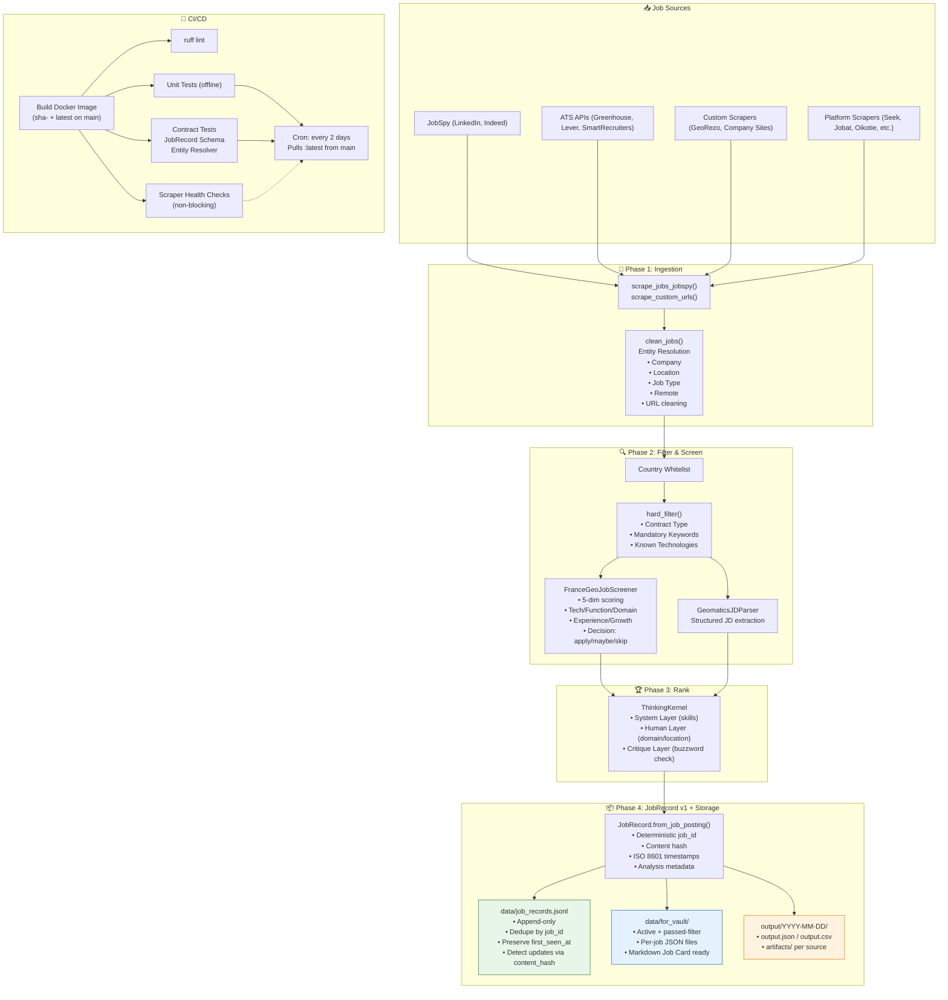
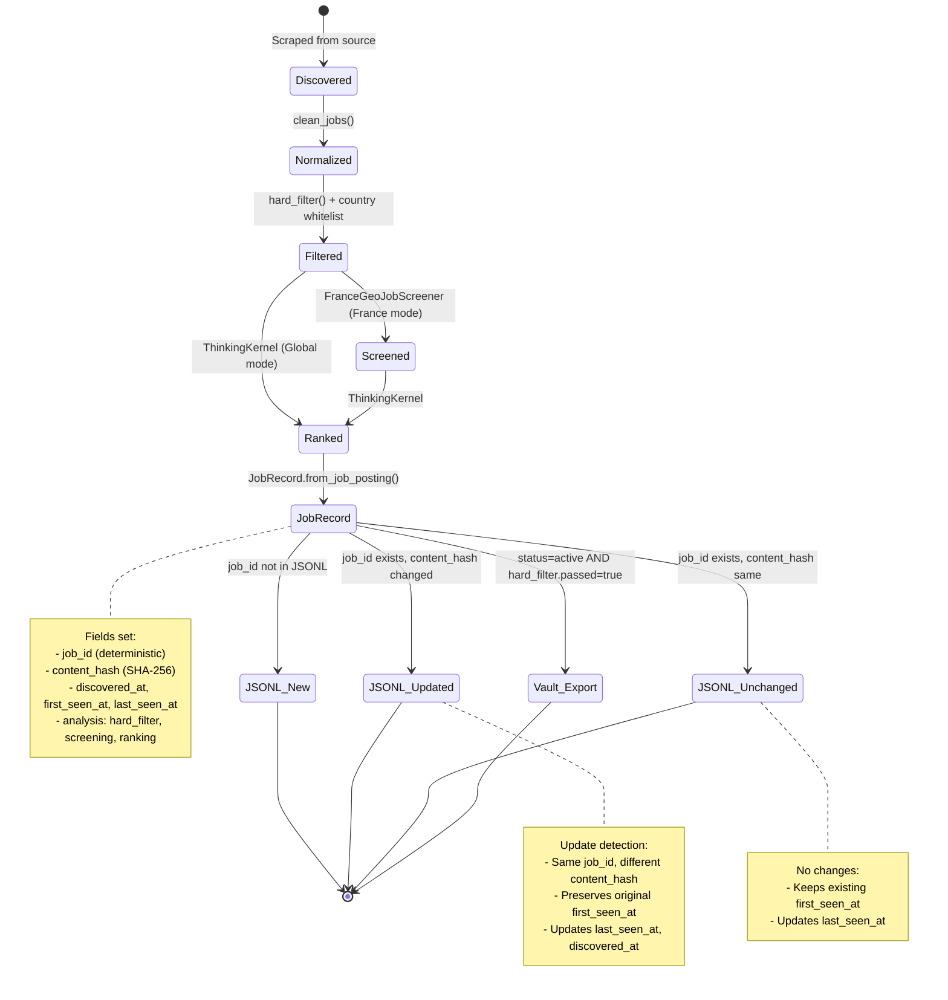
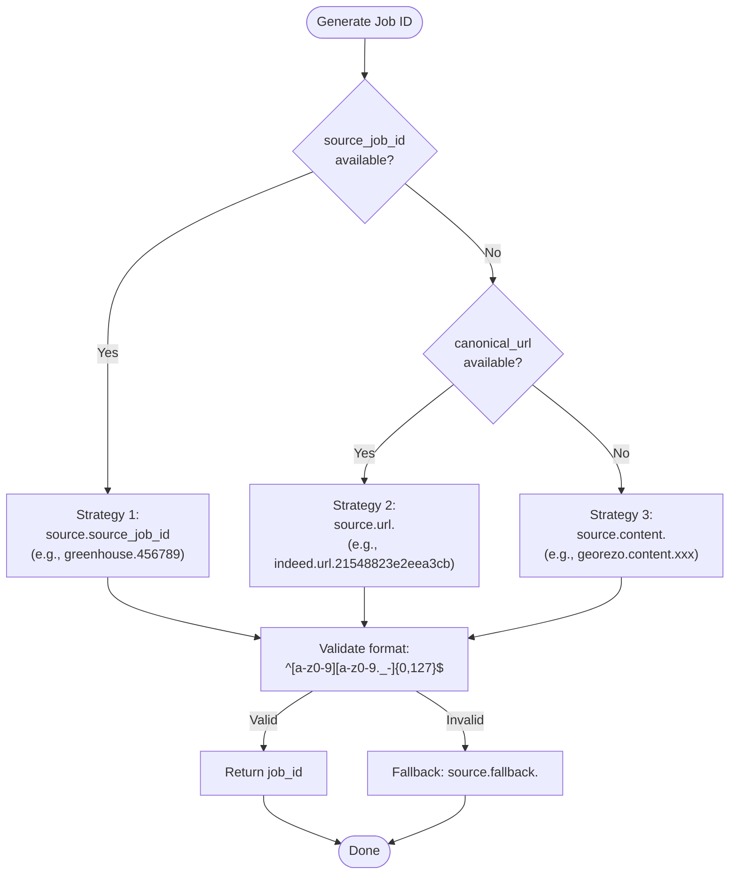
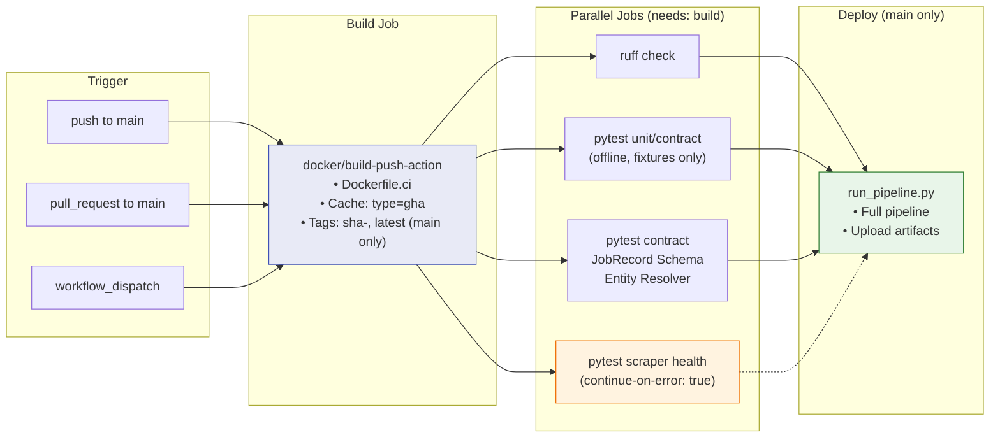
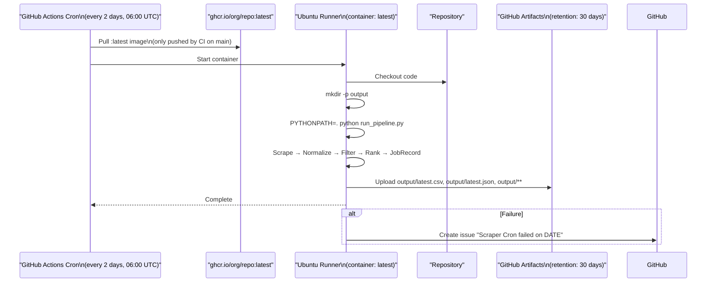
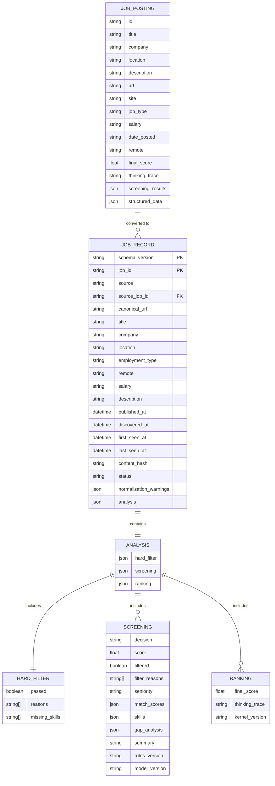
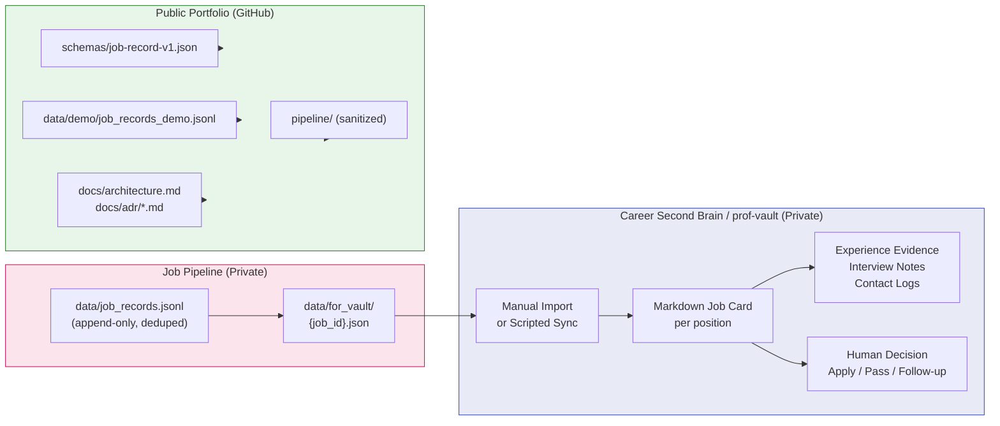

# Architecture Diagrams

This document contains Mermaid diagrams describing the Career Intelligence Pipeline architecture.

---

## 1. End-to-End Data Flow

---

## 2. JobRecord v1 Lifecycle

---

## 3. Deterministic Job ID Generation

---

## 4. CI/CD Pipeline

---

## 5. Cron Scraper (Decoupled from CI)

---

## 6. Data Model Relationships

---

## 7. Vault Integration Flow

