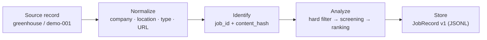

# Case Study: One Posting, End to End

> Every value below comes from [`data/demo/job_record_demo_1.json`](../data/demo/job_record_demo_1.json), a sanitized demo record. No production data is used.
>
> Résumé en français : [case-study.fr.md](case-study.fr.md).

This walkthrough follows one posting through the same stages as `pipeline/runner.py`: normalize, identify, analyze, store. The point is not this specific job — it is that the same input always produces the same identity and the same audit trail.



## 1. The source record

| Field | Value |
|---|---|
| `source` | `greenhouse` |
| `source_job_id` | `demo-001` |
| `title` | Senior Data Engineer - Geospatial Platform |
| `company` | TechCorp |
| `location` | Paris |
| `employment_type` | CDI |
| `remote` | Partial |
| `salary` | 65k-85k EUR |
| `published_at` | 2026-09-15T10:00:00Z |

Description excerpt:

> We are looking for a Senior Data Engineer to join our Geospatial Platform team. You will design and build scalable data pipelines for processing satellite imagery and location data. Required: 5+ years experience with Python, SQL, and cloud platforms (AWS/GCP). Strong experience with PostGIS, GDAL, and geospatial data formats (GeoJSON, GeoParquet).

`salary` is preserved as-is; sources that omit it produce `null`, not a guess.

## 2. Normalize before storing

The entity resolver maps source-specific spellings into canonical values:

| Raw concept | Stored value |
|---|---|
| Company name | `TechCorp` |
| Location | `Paris` |
| Contract label | `CDI` |
| Remote policy | `Partial` |
| URL | tracking parameters stripped |

If a field cannot be normalized confidently, the original value is kept and `normalization_warnings` records why. The pipeline does not invent a canonical value.

## 3. Identity: stable ID + change hash

Two identifiers answer two different questions.

**`job_id` — which posting is this?**

`greenhouse.demo-001` is produced by strategy 1: `source` + stable `source_job_id` (ADR 0002). If the source does not expose a stable ID, the fallback chain is:

| Strategy | Example for this record |
|---|---|
| 1. `source` + `source_job_id` | `greenhouse.demo-001` |
| 2. Hash of canonical URL | `greenhouse.url.09485e0b1c3fdb18` |
| 3. Hash of title / company / location | `greenhouse.content.a6063c4587674835` |

**`content_hash` — has the content changed?**

`681dee77769628993dc6ddb6d46abe0b31e10979e9031e6a6e8664fe90331b38` is the SHA-256 of `title|company|location|description` for this record. Re-running against the same posting keeps the `job_id`; editing the description keeps the `job_id` but changes the hash. For illustration, replacing `5+ years` with `7+ years` in the demo description yields `e9b6f9292ff29a679fa096d9efa3ec24ef75254d42dfd46ad98d032c4d325ebd` (not stored).

## 4. Analysis: three separate blocks

Analysis never overwrites the raw fields; it is stored alongside them, with the rules and model versions that produced it.

**Hard filter** — `passed: true`, no missing skills. This is a candidate-specific gate configured outside the public snapshot.

**Screening** — decision: `apply`, score: `92.5`, seniority: `senior`.

| Dimension | Score |
|---|---|
| `tech_match` | 95.0 |
| `function_match` | 90.0 |
| `domain_match` | 95.0 |
| `experience_match` | 90.0 |
| `growth_potential` | 88.0 |

Extracted skills: `postgis`, `gdal`, `geoparquet`, `geojson` (GIS); `python`, `sql`, `airflow`, `dbt` (data); `aws`, `gcp`, `docker`, `kubernetes`, `terraform` (DevOps). Gap analysis is empty; leverage points are senior geospatial expertise, cloud-native data platforms, and ML collaboration.

**Ranking** — final score: `94.2`.

> Strong tech match (Python, PostGIS, GDAL, Cloud), perfect domain alignment (geospatial), senior experience match.

Versions are recorded with the result: `rules_version: 1.0`, `model_version: qwen2.5:7b-instruct`, `kernel_version: 1.0`.

## 5. Stored output

```json
{
  "schema_version": "1.0.0",
  "job_id": "greenhouse.demo-001",
  "source": "greenhouse",
  "source_job_id": "demo-001",
  "canonical_url": "https://boards-api.greenhouse.io/v1/boards/techcorp/jobs/demo-001",
  "title": "Senior Data Engineer - Geospatial Platform",
  "company": "TechCorp",
  "location": "Paris",
  "employment_type": "CDI",
  "remote": "Partial",
  "salary": "65k-85k EUR",
  "first_seen_at": "2026-10-10T12:00:00Z",
  "last_seen_at": "2026-10-10T12:00:00Z",
  "content_hash": "681dee77769628993dc6ddb6d46abe0b31e10979e9031e6a6e8664fe90331b38",
  "status": "active",
  "analysis": { "...": "hard_filter + screening + ranking" }
}
```

The full record is in [`data/demo/job_record_demo_1.json`](../data/demo/job_record_demo_1.json) and validates against [`schemas/job-record-v1.json`](../schemas/job-record-v1.json).

## 6. What happens on the next run

| Situation | `job_id` | `content_hash` | `first_seen_at` | Behavior |
|---|---|---|---|---|
| Same posting, same content | unchanged | unchanged | preserved | one record, no duplicate |
| Same posting, edited description | unchanged | new | preserved | update detected |
| New posting | new | new | current run | new record |

Two scope boundaries are explicit rather than hidden:

- **Identity is source-scoped.** The same role published on two boards yields two records. Entity resolution normalizes company and location strings, but cross-source job matching is not implemented.
- **The JSONL file is a snapshot keyed by `job_id`.** Postings absent from a run are not retained, and automatic `closed` / `expired` transitions are not implemented yet; `status` exists in the contract for that lifecycle.

## 7. What a team can take from this

- **Idempotent ingestion** — stable IDs make re-runs safe.
- **Change detection** — content hashes expose edited descriptions without diffing raw HTML.
- **Auditability** — raw data and analysis stay separate; rules and model versions travel with the verdict.
- **A testable contract** — every record validates against a versioned schema in CI.

The reusable pieces are the [schema](../schemas/job-record-v1.json), the [identity rules](adr/0002-deterministic-job-id.md), and the [privacy boundary](adr/0004-privacy-boundary.md) — each can be adopted without the scrapers.
